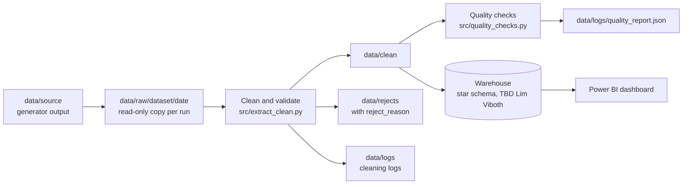

# HR Employee Data Engineering Pipeline

Group 2, Data Engineering Capstone, Option 2.

This pipeline takes synthetic HR data through five steps: ingest, clean, quality check, load into a star-schema warehouse, and report in Power BI. All data is synthetic, and no dataset holds names, phones, emails or addresses. Reports go no deeper than `employee_id`.

## Team

| Role | Track | Main files |
|---|---|---|
| Chea&nbsp;Dalin | Data and Quality | `src/generate_data.py`, `src/extract_clean.py`, `src/quality_checks.py`, `dag/hr_pipeline_dag.py`, `notebooks/profiling.ipynb` |
| Lim&nbsp;Viboth | Warehouse and Airflow | `docker-compose.yml`, `sql/create_star_schema.sql`, `dag/hr_pipeline.py`, load scripts (TBD) |
| Sun&nbsp;Vicheka | Analytics and Documents | `README.md`, `deliverables/` (documents, roadmap, slides, Power BI), `sql/report_views.sql`, `tests/test_report_views.py`, submission |

## Problem

HR data is spread across separate files with duplicate employee IDs, missing values, mixed label styles and bad dates. Managers cannot trust the numbers built from it.

The pipeline:

- joins three HR datasets: employees, attendance and performance;
- fixes bad rows or rejects them with a reason;
- loads clean data into a star schema;
- reports headcount, department distribution, attendance trends and approved performance in Power BI.

## Architecture



The pipeline is ETL: data is cleaned and validated before it is loaded, so only good rows reach the warehouse. Bad rows are written to `data/rejects` with a reason. Nothing is lost, and every run can be repeated.

## Quick start

Requirements: Docker Desktop and Git.

1. Clone the repo and open the folder.
2. Run `cp .env.example .env`, then fill in `.env`: `MYSQL_DATABASE`, `MYSQL_ROOT_PASSWORD`, `MYSQL_USER`, `MYSQL_PASSWORD`, `MYSQL_HOST_PORT`, `AIRFLOW_IMAGE_NAME`, `AIRFLOW_UID`. Never commit `.env`.
3. Run `docker compose up -d`.
4. Open <http://localhost:8080>. Airflow runs in standalone mode, so the admin password is in the container log: `docker compose logs airflow`.
5. Trigger the DAG `hr_pipeline_extract_clean` by hand. It has no schedule.

Run outputs:

| Output | Location |
|---|---|
| Raw copy | `data/raw/<dataset>/<run date>/` |
| Clean data | `data/clean/` |
| Rejected rows | `data/rejects/` |
| Cleaning logs, quality report | `data/logs/` |

To regenerate the synthetic data, run `python src/generate_data.py`. It overwrites `data/source/` and writes `data/reference/departments.csv`.

## DAG

`hr_pipeline_extract_clean` lives in `dag/hr_pipeline_dag.py`. It starts on 2026-11-01, runs only on a manual trigger and does not catch up missed runs.

```text
ingest_to_raw >> [clean_employees, clean_attendance, clean_performance] >> quality_checks
```

| Task | What it does |
|---|---|
| `ingest_to_raw` | Copies `data/source` into `data/raw/<dataset>/<run date>/` |
| `clean_*` (3 tasks, parallel) | Cleans one dataset; writes clean rows, rejects and logs |
| `quality_checks` | Runs the quality rules. Any FAIL fails the task; WARN does not |

Planned load tasks (TBD, Lim Viboth): `load_dimensions`, `load_facts` and `refresh_report_views`. The final DAG name and task list are not decided yet.

## Data quality

Latest run (`data/logs/quality_report.json`, 2026-11-08): **19 PASS, 1 WARN, 0 FAIL**. The WARN covers 32 Present or Late attendance rows with no `check_in`. These rows are kept and logged.

| Dataset | Rows in | Exact duplicates dropped | Rejected | Rows out |
|---|---|---|---|---|
| employees | 206 | 3 | 3 | 200 |
| attendance | 13,040 | 40 | 83 | 12,917 |
| performance | 410 | 10 | 28 | 372 |

Rules, reject reasons and retention: [governance.md](deliverables/01_Documentation/governance.md).

## Warehouse

Star schema `ANALYTICS`, defined in `sql/create_star_schema.sql`:

| Table | Type | Grain or content |
|---|---|---|
| `fact_attendance` | Fact | One row per employee per day |
| `fact_performance` | Fact | One row per employee per half-year review period |
| `dim_employee` | Dimension | Employee attributes, including department and division; no personal columns |
| `dim_date` | Dimension | Calendar date, key `YYYYMMDD` |
| `dim_attendance_status` | Dimension | Present, Late, Absent, Leave |
| `dim_review_period` | Dimension | 2025-H2, 2026-H1 |

**Open decision (TBD, Lim Viboth): which warehouse engine.** The repo currently points three ways:

- `docker-compose.yml` runs MySQL 8.0.
- `sql/create_star_schema.sql` and `dag/hr_pipeline.py` use Snowflake.
- The roadmap says PostgreSQL.

There is also no separate department dimension yet, which the project brief suggests adding.

## Dashboard

Power BI, built by Sun Vicheka, with four pages:

1. Headcount overview
2. Department distribution
3. Attendance trends
4. Approved performance (only page filtered to `reviewer_status = 'Approved'`)

Definitions:

- **Headcount** counts employees whose `employment_status` is Active or On Leave. Resigned employees are excluded.
- **Attendance rate** is (Present + Late) / all attendance rows.

The pages read from the views in `sql/report_views.sql`. Run `pip install duckdb sqlglot` and then `tests/test_report_views.py` to check those views. Page layout and measures are in `dashboard_plan.md` (not in the repo yet). The report file and a PDF export are in [deliverables/05_Analytics_PowerBI/](deliverables/05_Analytics_PowerBI/).

## Documentation

| Document | Purpose |
|---|---|
| [data_dictionary.md](deliverables/01_Documentation/data_dictionary.md) | Tables, columns, types and rules |
| [governance.md](deliverables/01_Documentation/governance.md) | Access roles, quality rules, retention, privacy |
| [HR_Pipeline_Roadmap.html](deliverables/02_Roadmap_and_Timeline/HR_Pipeline_Roadmap.html) | Roadmap, timeline, phases and handovers |
| [Slide deck](deliverables/03_Slide_Presentation/index.html) | Presentation; open `index.html` in a browser |
| [Video](deliverables/04_Video_Presentation/) | Video presentation |
| [Power BI](deliverables/05_Analytics_PowerBI/) | `HR Employee Analytics.pbix` and a PDF export of its pages |

## Repository layout

```text
dag/
  hr_pipeline.py            Connection config and helpers, no DAG object (Lim Viboth)
  hr_pipeline_dag.py        DAG hr_pipeline_extract_clean (Chea Dalin)
data/
  source/                   Generator output: employees.xlsx, attendance.csv, performance.csv, injected_errors.json
  raw/<dataset>/<date>/     Read-only copy of source files per run
  clean/                    employees_clean.csv, attendance_clean.csv, performance_clean.csv
  rejects/                  Failed rows with reject_reason, one file per dataset
  logs/                     Cleaning logs per dataset, quality_report.json
  reference/                departments.csv (official departments and divisions)
deliverables/
  01_Documentation/         data_dictionary.md, governance.md
  02_Roadmap_and_Timeline/  HR_Pipeline_Roadmap.html
  03_Slide_Presentation/    index.html (slide deck), app.js, styles.css, assets/
  04_Video_Presentation/    Video recordings (Git LFS)
  05_Analytics_PowerBI/     HR Employee Analytics.pbix and .pdf
notebooks/profiling.ipynb   Data profiling notes
sql/
  create_star_schema.sql    Star schema tables (Snowflake syntax)
  report_views.sql          Report views for Power BI
src/
  generate_data.py          Synthetic data with injected errors
  extract_clean.py          Ingest, clean, validate; write clean and rejects
  quality_checks.py         Run quality rules, write the report
tests/test_report_views.py  Checks the report views
docker-compose.yml          MySQL 8.0 and Airflow
.env.example                Environment variable names
```

## Contributing

1. Branch from `dev`, for example `feature/my-change`.
2. Commit small changes with clear messages.
3. Open a pull request into `dev`, get a review from another member, then merge.
4. Merge `dev` into `main` by pull request.

Rules:

- Use synthetic data only.
- Never edit files in `data/raw`.
- If you are stuck for more than half a day, tell the group chat.

## Status

The project runs from 3 to 18 Nov 2026. Status as of 9 Nov 2026:

| Roadmap item | Owner | Due | Status |
|---|---|---|---|
| Synthetic data generator | Chea&nbsp;Dalin | 3-6 Nov | Done |
| Raw lake folders | Chea&nbsp;Dalin | 6-7 Nov | Done |
| Profile data quality | Chea&nbsp;Dalin | 7-8 Nov | Done |
| Extract and clean code | Chea&nbsp;Dalin | 8-10 Nov | Done |
| Data quality checks | Chea&nbsp;Dalin | 9-11 Nov | Done |
| Add cleaning and checks to DAG | Chea&nbsp;Dalin | 11-12 Nov | Done |
| Docker, database, Airflow | Lim&nbsp;Viboth | 3-5 Nov | Done |
| Star schema and CREATE TABLE | Lim&nbsp;Viboth | 6-8 Nov | Done |
| Load scripts (dimensions, then facts) | Lim&nbsp;Viboth | 9-11 Nov | Done |
| Airflow DAG end to end (first green run 13 Nov) | Lim&nbsp;Viboth | 11-13 Nov | Done |
| GitHub repo, task board, README | Sun&nbsp;Vicheka | 3-4 Nov | Done |
| Data dictionary | Sun&nbsp;Vicheka | 6-8 Nov | Done |
| Governance document | Sun&nbsp;Vicheka | 8-11 Nov | Done |
| Dashboard plan | Sun&nbsp;Vicheka | Not in roadmap | Done |
| Connect Power BI to warehouse | Sun&nbsp;Vicheka | 12-13 Nov | Done |
| Power BI dashboard | Sun&nbsp;Vicheka | 13-15 Nov | Done |
| Final slide deck, plan video | Sun&nbsp;Vicheka | 16 Nov | Done |
| PR reviews and fixes | Everyone | 13-15 Nov | Done |
| Slides for every part | Sun&nbsp;Vicheka | 15 Nov | Done |
| Record video | Everyone | 17 Nov | Done |
| Submit | Sun&nbsp;Vicheka | 18 Nov | Done |

## Submission

Sun Vicheka submits by Wednesday 18 November 2026:

- GitHub source code: this repository
- Documentation: [deliverables/01_Documentation/](deliverables/01_Documentation/)
- Roadmap and timeline: [deliverables/02_Roadmap_and_Timeline/](deliverables/02_Roadmap_and_Timeline/)
- Slide presentation: [deliverables/03_Slide_Presentation/](deliverables/03_Slide_Presentation/)
- 15-20 minute video with demo: [deliverables/04_Video_Presentation/](deliverables/04_Video_Presentation/)
- Power BI dashboard: [deliverables/05_Analytics_PowerBI/](deliverables/05_Analytics_PowerBI/)
- Group number and member names: Group 2, Chea Dalin, Lim Viboth, Sun Vicheka
